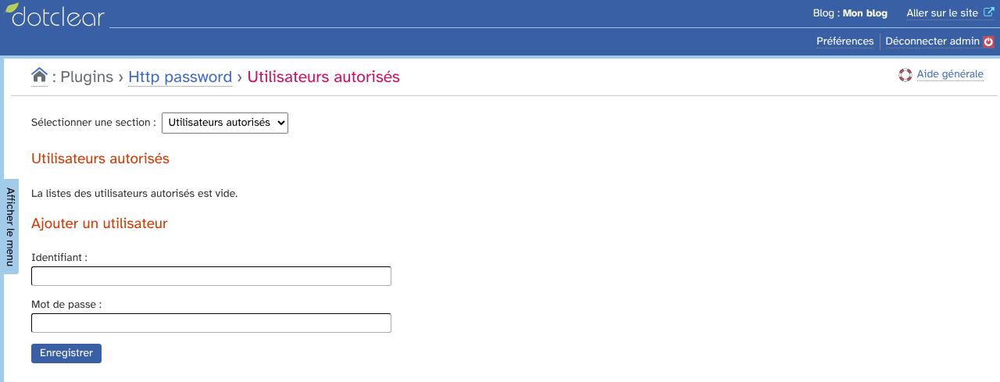
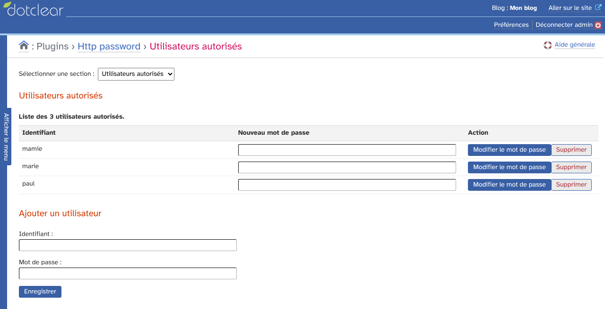
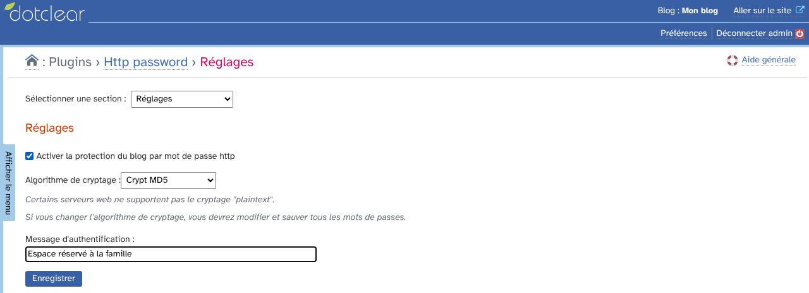
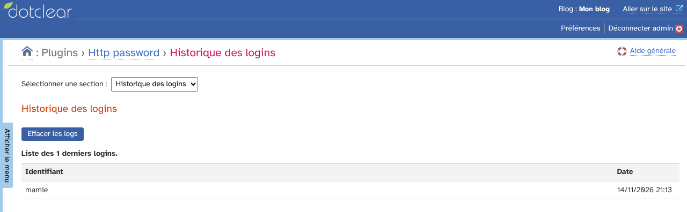

# httpPassword : guide d'utilisation

httpPassword rend votre blog privé.
Chaque visiteur doit saisir un identifiant et un mot de passe avant de voir une page publique du blog.
Le navigateur affiche pour cela sa propre fenêtre de connexion.

Les utilisateurs autorisés sont enregistrés dans un fichier `.htpasswd`, rangé dans le dossier public de votre blog.
Cette protection ne concerne pas l'administration du blog : vous vous y connectez comme d'habitude.

## Sommaire

* [Avant de commencer](#avant-de-commencer)
* [Ajouter un utilisateur](#ajouter-un-utilisateur)
* [Régler la protection](#régler-la-protection)
* [Activer la protection](#activer-la-protection)
* [Changer un mot de passe](#changer-un-mot-de-passe)
* [Supprimer un utilisateur](#supprimer-un-utilisateur)
* [Voir les connexions](#voir-les-connexions)
* [Désactiver la protection](#désactiver-la-protection)

## Avant de commencer

Ouvrez le menu « Plugins », puis « Http password ».
La page est découpée en trois sections : « Réglages », « Historique des logins » et « Utilisateurs autorisés ».
Choisissez la section dans la liste « Sélectionner une section ».

Le plugin doit pouvoir écrire dans le dossier public du blog.
Si ce n'est pas le cas, la page affiche l'avertissement « Aucun droit d'écriture sur le répertoire du blog. » et ne montre que les réglages.

## Ajouter un utilisateur

Commencez par créer au moins un utilisateur, avant d'activer la protection.
Sinon, plus personne ne pourra entrer sur le blog.

Choisissez la section « Utilisateurs autorisés ».
Tant qu'il n'y a personne, la page affiche « La listes des utilisateurs autorisés est vide. ».

Dans « Ajouter un utilisateur », remplissez les deux champs :

* **Identifiant** : le nom que le visiteur saisira.
* **Mot de passe** : son mot de passe. Le champ est un champ texte : le mot de passe est visible quand vous le tapez.

Cliquez sur « Enregistrer ».
L'utilisateur apparaît dans la liste, classée par ordre alphabétique.
Si l'identifiant existe déjà, son mot de passe est remplacé.

## Régler la protection

Choisissez la section « Réglages ».

* **Algorithme de cryptage** : la façon dont les mots de passe sont rangés dans le fichier. « Crypt MD5 » est choisi par défaut. « Crypt SHA256 » et « Crypt SHA512 » conviennent aussi.
* **Message d'authentification** : le texte écrit dans la fenêtre de connexion du navigateur. Par défaut : « Private space ».

Évitez deux choix de la liste :

* « pas de cryptage » : les mots de passe sont écrits tels quels dans le fichier, et les visiteurs ne peuvent pas se connecter ;
* « Crypt Blowfish » : le mot de passe enregistré est inutilisable, et les visiteurs ne peuvent pas se connecter.

Si vous changez l'algorithme, saisissez à nouveau le mot de passe de chaque utilisateur, pour qu'il soit enregistré avec le nouvel algorithme.

## Activer la protection

Cochez « Activer la protection du blog par mot de passe http », puis cliquez sur « Enregistrer ».
La page affiche « Paramètres mis à jour. ».

Dès cet instant, toutes les pages publiques du blog demandent un identifiant et un mot de passe.
Un visiteur qui annule la fenêtre ou qui se trompe ne voit rien du blog.

Le fichier `.htpasswd` contient les identifiants et les mots de passe cryptés.
Vérifiez que votre serveur ne le montre pas : l'adresse `/public/.htpasswd` de votre blog ne doit pas afficher son contenu.
Le serveur Apache le refuse en général.

## Changer un mot de passe

Choisissez la section « Utilisateurs autorisés ».
Écrivez le nouveau mot de passe dans la colonne « Nouveau mot de passe », sur la ligne de l'utilisateur.
Cliquez sur « Modifier le mot de passe ».
La page affiche « Logins mis à jour. ».

Ne cliquez pas sur le bouton avec le champ vide : le mot de passe de l'utilisateur serait effacé, et il ne pourrait plus se connecter.

## Supprimer un utilisateur

Sur la ligne de l'utilisateur, cliquez sur « Supprimer ».
L'utilisateur est retiré tout de suite, sans demande de confirmation.
Il ne peut plus entrer sur le blog.

## Voir les connexions

Choisissez la section « Historique des logins ».
Le tableau indique l'identifiant et la date de la dernière connexion d'un utilisateur autorisé.

Le bouton « Effacer les logs » vide l'historique.
La page affiche « Logs effacé. », puis « L'historique des logins est vide. ».

## Désactiver la protection

Décochez « Activer la protection du blog par mot de passe http », puis cliquez sur « Enregistrer ».
Le blog redevient public tout de suite.
Le fichier `.htpasswd` et les utilisateurs sont conservés : vous retrouvez la liste en réactivant la protection.
